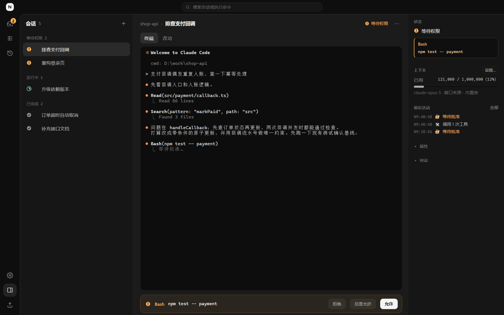
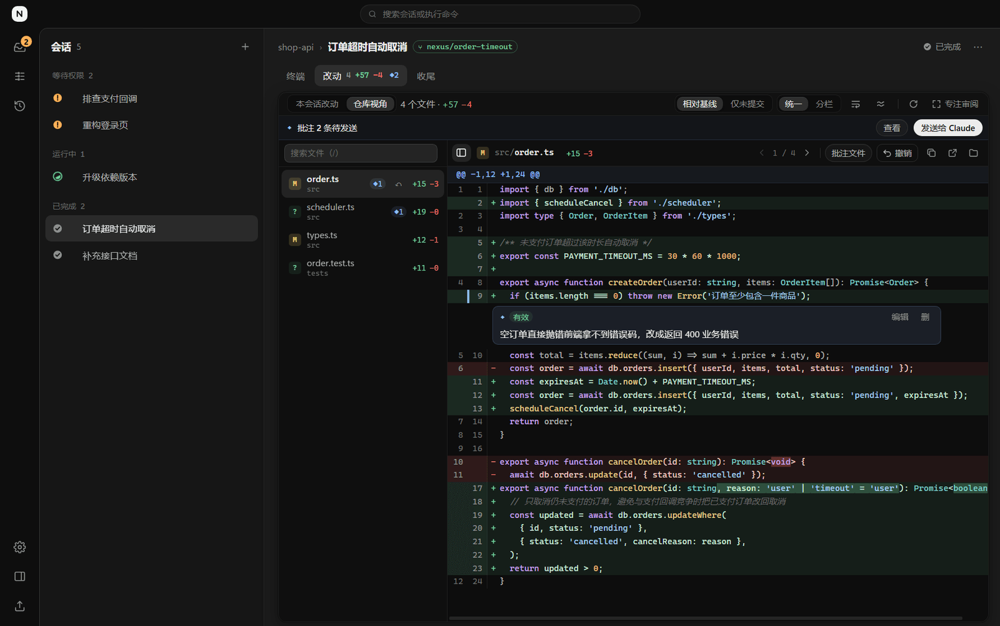
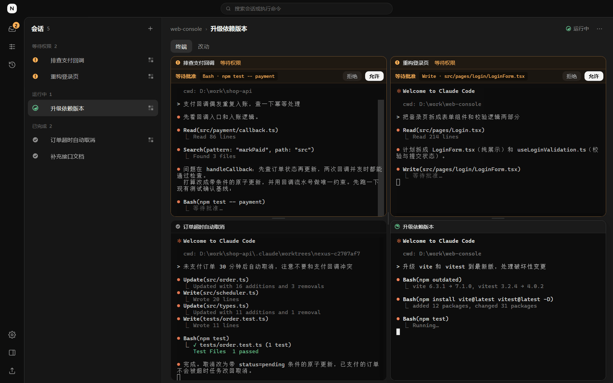
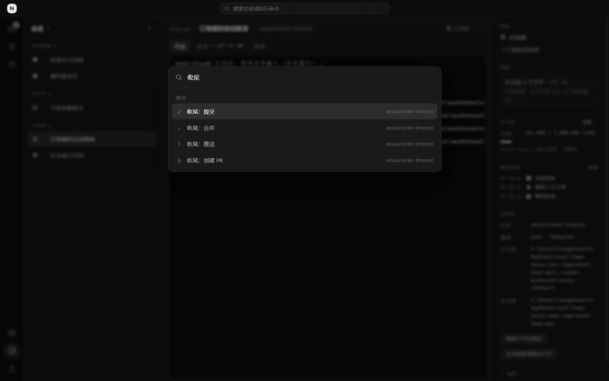
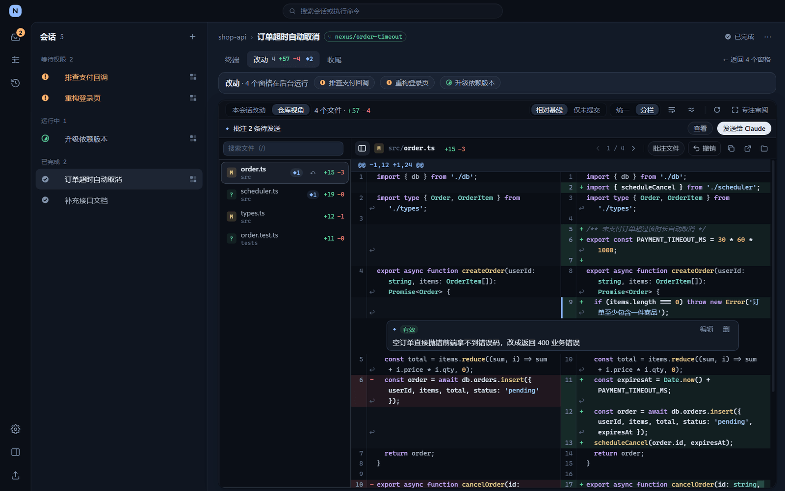

# Claude Nexus

**Windows 原生的 Claude Code 多会话指挥台**

同时开十个 Claude Code，谁在等审批、谁跑完了、改了哪些文件，一眼看清，一键处理。

[下载安装包](https://github.com/YesXXX/claude-nexus/releases/latest) · [使用手册](docs/使用手册.md) · [更新日志](CHANGELOG.md) · [参与贡献](CONTRIBUTING.md)

## 为什么做它

在多个终端窗口里各跑一个 Claude Code，很快就会乱：不知道哪个在等你批准，切过去才发现它已经干等了十分钟；两个会话同时改同一个仓库互相打架；改完一大堆文件，只能回到命令行一个个 `git diff`。

Claude Nexus 把这些会话收进一个窗口：真实终端直通，状态靠 Claude Code 自己的 hook 上报，不猜、不轮询。不需要 WSL 和 tmux，Windows 上装好就能用。

## 功能一览

- **多会话与一键审批**：会话按「待审批 / 待输入 / 运行中 / 已完成」自动分组；等你批准时弹系统通知，点通知直达，`Y` / `N` / `A` 一键审批；最多 4 个窗格并排，非焦点窗格里的审批也能直接点
- **独立工作区**：勾一下就用 `git worktree` 给会话建独立分支，多个 Claude 改同一仓库互不干扰；同一个任务可以一次派给 N 个工作区，并排比较后保留最好的方案
- **改动审阅与批注**：看本会话实际改了哪些文件，diff 带语法高亮与分栏；在 diff 行上写修改意见，攒够了一次发回给 Claude；单个文件可撤销，撤销前自动备份
- **工作区收尾**：在面板里提交（可让 Claude 生成提交信息）、合并、推送、创建 PR；合并冲突时一键开一个带冲突清单的会话去解决
- **会话续接**：进程退出、面板重启后接着同一段对话继续，也可以分叉成新会话；结束的会话进历史，可搜索、可续接
- **离开时也不漏**：每轮结束自动跑你配置的测试命令，失败输出一键发给 Claude 修；需要你处理时推送到企业微信、钉钉、飞书群机器人；上下文快满时提醒
- **随手可达**：`Ctrl+K` 命令面板覆盖全部操作，提示词模板支持变量，三套深色皮肤

<table>
<tr>
<td width="50%"> 改动审阅：语法高亮 diff、按行批注</td>
<td width="50%"> 多窗格：最多 4 个会话并排</td>
</tr>
<tr>
<td width="50%"> 命令面板：Ctrl+K 直达一切</td>
<td width="50%"> 分栏 diff，夜蓝皮肤（另有石墨、暖灰）</td>
</tr>
</table>

## 安装

**前置条件**

- Windows 10 / 11 x64
- 已安装 [Claude Code](https://docs.anthropic.com/claude-code)，能在终端里运行 `claude`
- `node` 在 PATH 里（Claude Code 通过 hook 向面板上报状态时用它执行脚本；用 npm 装 Claude Code 的话已经满足）
- 用独立工作区、改动审阅、收尾时需要 Git；创建 PR 需要已登录的 [gh](https://cli.github.com/)（没有也能用，会降级为复制命令）

**安装**

到 [Releases](https://github.com/YesXXX/claude-nexus/releases/latest) 下载 `ClaudeNexus-Setup-vX.Y.Z.exe`，双击即装（装到用户目录，不需要管理员权限）。安装包暂未做代码签名，Windows SmartScreen 提示时选「更多信息 → 仍要运行」；也可以对照 Release 里的 `SHA256SUMS.txt` 校验文件。

想从源码运行或自己出包，见 [开发指南](docs/开发指南.md)。

## 快速上手

1. 打开面板，首页即新建表单：选工作目录，可选填首条提示词，回车创建
2. 想让它在独立分支上干活，勾选「独立工作区」
3. 会话等你批准时，列表里会亮起并弹系统通知，按 `Y` 允许、`N` 拒绝、`A` 总是允许
4. 一轮跑完，`Ctrl+Shift+D` 切到「改动」看 diff，有意见就在行上批注，再发回给 Claude
5. 满意了，`Ctrl+Shift+F` 切到「收尾」提交、合并或开 PR

常用快捷键：`Ctrl+K` 命令面板 · `Ctrl+1~9` 切换会话 · `J` / `K` 上下切换 · `Ctrl+,` 设置 · `Alt+Shift+C` 全局唤起。完整列表在设置页「快捷键」。

## 它怎么工作

- 每个会话是一个 node-pty 伪终端里的真实 `claude` 进程，你看到和输入的就是 Claude Code 本身，面板不改它的行为
- 面板为每个会话生成专属的 `--settings`，只追加几个 hook 用来上报状态，不改你自己的 Claude Code 配置
- 上下文占用读取 Claude Code 自己写的对话记录，只读、不上传
- 面板的数据都在 `~/.claude-session-panel/`，除了你主动配置的群机器人推送，不连接任何外部服务

## 常见问题

**和 Claude Code 官方的桌面端、`claude --worktree` 有什么区别？**
官方工具管一个会话很好用。Nexus 解决的是同时管很多个：集中审批、跨会话的状态与通知、改动审阅加批注回传、多方案并排比较、在面板里完成合并收尾。两者可以并用。

**支持 macOS / Linux 吗？**
目前只支持 Windows。代码里平台相关的部分不多，欢迎有兴趣的朋友来移植。

**会消耗额外的额度吗？**
不会。面板只在你点「请 Claude 生成提交信息」时额外调用一次 `claude -p`，其余操作都不调用模型。

**我的代码会被上传吗？**
不会。面板本身不联网（检查更新只读你配置的目录，群机器人推送只发会话名和状态摘要，不含代码和完整路径）。

## 文档

- [使用手册](docs/使用手册.md)：每个功能的完整说明
- [开发指南](docs/开发指南.md)：环境、测试、渲染层扩展点
- [发布流程](docs/发布流程.md)：签名更新与 GitHub Releases
- [参与贡献](CONTRIBUTING.md) · [安全策略](SECURITY.md) · [更新日志](CHANGELOG.md)

## 许可证

[MIT](LICENSE)

Claude Nexus 是社区项目，与 Anthropic 无关。Claude 与 Claude Code 是 Anthropic 的商标。
